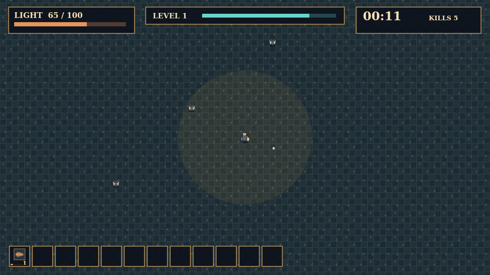

# Wick — Keep the Light

A single lamplighter has ten minutes until dawn. The first moth is easy to miss. Soon bats, beetles, shades, and whole swarms move toward the lamp, and the street is a fight for every step.

You only walk. Your tools swing, pulse, and fly on their own rhythms, so every turn is a choice of where to stand and which danger to cross. Fallen creatures leave gems that fill the lamp with experience; every new level asks you to choose one of three tools or trinkets.

There is room for six tools and six trinkets. The great creatures leave chests, and a chest can transform a tool you have mastered when its matching trinket is in hand. Choose a path through the crowd, build a lamp that holds, and stay alive until the clock reaches 10:00.

